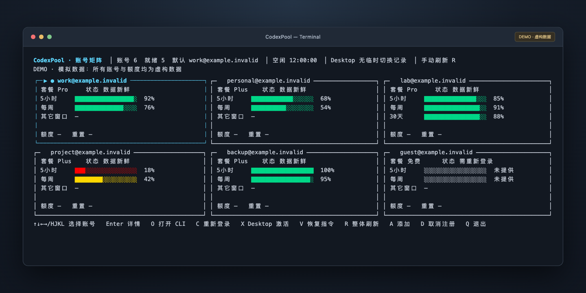
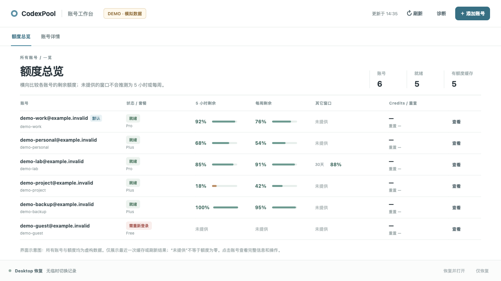

# CodexPool

**Your Codex accounts, at a glance in the terminal.**

CodexPool is a terminal-first local Codex account manager written in Go. Its main interface is a Chinese TUI with account cards, usage bars, keyboard navigation, and shortcuts to launch the official Codex CLI. It also provides CLI commands and a local web console.

### Terminal dashboard · Primary interface



Run `./codexpool.sh` to open the terminal dashboard. Use the arrow keys or `H/J/K/L` to select an account, `Enter` for details, `O` to open Codex, and `R` to refresh usage.

### Web console · An alternative view



Run `./codexpool-web.sh` to view the same local account data in a browser.

*Both previews use the project's existing UI code with fictional data. All accounts, plans, and usage values are examples; no real account screenshot is used.*

[中文文档](README.md) · [Usage](docs/usage.md) · [Desktop helper](docs/desktop.md) · [Security model](docs/security-model.md) · [Compatibility](docs/compatibility.md)

Version `0.1.0-preview.1`. Primarily targets macOS. This is an independent project, not an official OpenAI product. The current UI and detailed documentation are primarily in Chinese.

## Features

- Responsive terminal account cards with keyboard navigation and account details.
- Local web console with account search, quota comparisons, plan details, other server-provided windows, Credits, and refresh controls.
- Separate `CODEX_HOME` directories with immutable random profile IDs.
- Login, reauthentication, and logout delegated to the official Codex CLI.
- Default profile selection and explicit per-account launches.
- Validated usage snapshots and cached fallback with explicit status. Missing limits stay unknown.
- Conservative `best` suggestions. Automatic execution and account rotation are disabled.
- Experimental macOS Desktop activation and restoration through a separately confirmed helper.
- Environment diagnostics and JSON output for scripting.

The web console binds only to a random loopback port. Its frontend is embedded in Go; Node.js is not required.

## Quick start

Install Go **1.24 or newer** and an official Codex CLI. On macOS, CodexPool can discover the CLI bundled with ChatGPT. Set `CODEXPOOL_CODEX_BIN` to use another executable location.

**Check compatibility before adding an account:** interactive execution and logout are pinned to Codex `0.154.0-alpha.6.2`. Login also accepts the reviewed exact version `0.160.0`; this does not enable other operations on that version. Read-only account/quota calls can try newer versions only if strict response validation succeeds. Windows authenticated profiles are disabled. Linux has no complete host validation matrix.

```bash
git clone https://github.com/GP-BYTE/CodexPool.git
cd CodexPool
./codexpool.sh --help
./codexpool.sh doctor --probe-runtime
./codexpool.sh add work
./codexpool.sh
```

The terminal dashboard is the primary entry point. For the optional web console, run `./codexpool-web.sh`, or use `./codexpool-web.sh --no-open` to print the local web address. Press `Ctrl+C` in the server terminal to stop it. The launch scripts use `go run`, which downloads dependencies on first use.

```bash
./codexpool.sh accounts
./codexpool.sh show work
./codexpool.sh switch work
./codexpool.sh open
./codexpool.sh open personal
./codexpool.sh relogin work
```

`switch` selects the CodexPool default; Desktop activation is a separate experimental operation. If an alias is omitted during `add`, the verified account email becomes the alias. The UI displays account emails; redact them before sharing screenshots.

## Privacy and data

Local state lives in `~/.codexpool`, configurable with `CODEXPOOL_HOME`. It can contain credentials, email addresses, account identifiers, and usage snapshots. Never upload it or set it to the repository root.

Everyday profile commands do not import or overwrite the default `~/.codex/auth.json`. The experimental Desktop helper temporarily changes that authentication file and stores private recovery data. Read the [Desktop guide](docs/desktop.md) before using it.

The project uses private file permissions, profile locks, atomic writes, and identity checks. It is not a sandbox against same-user malware or administrators. See the [security model](docs/security-model.md).

## Development

```bash
go mod verify
go test ./...
go test -race ./...
go vet ./...
go build -trimpath -buildvcs=false -o bin/codexpool ./cmd/codexpool
python3 scripts/check_public_export.py
```

Keep the source checkout for web-to-terminal actions, which invoke project scripts. See [contributing](CONTRIBUTING.md), [security reporting](SECURITY.md), and [releasing](docs/releasing.md).

Licensed under the [MIT License](LICENSE). See [third-party notices](THIRD_PARTY_NOTICES.md) for protocol evidence and dependencies.
